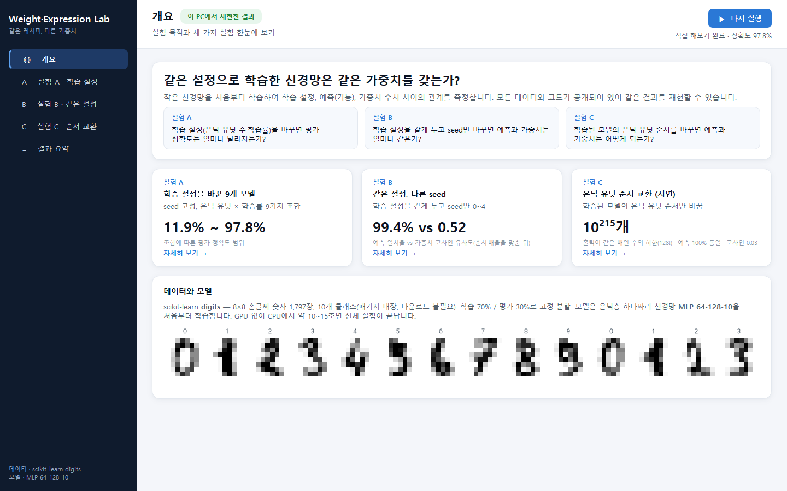
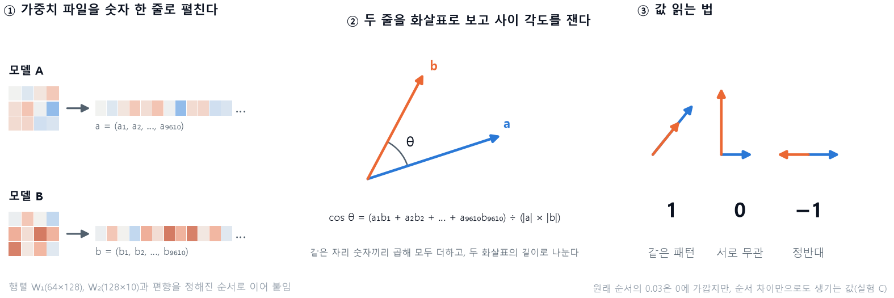
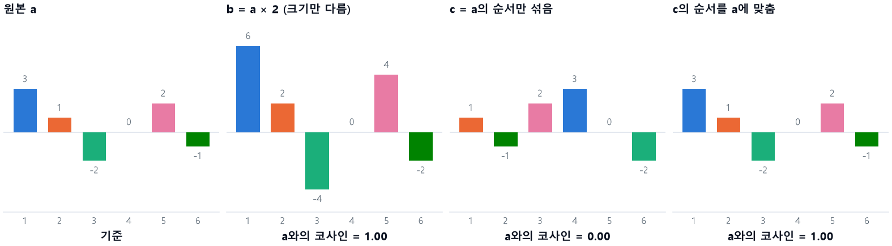
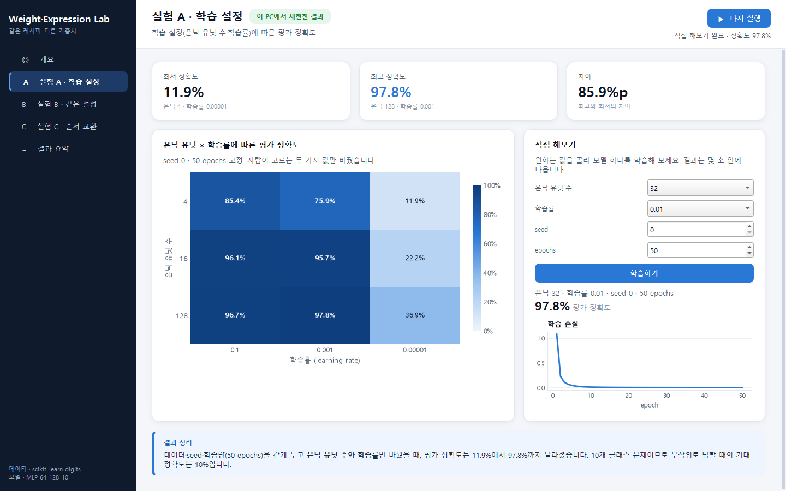
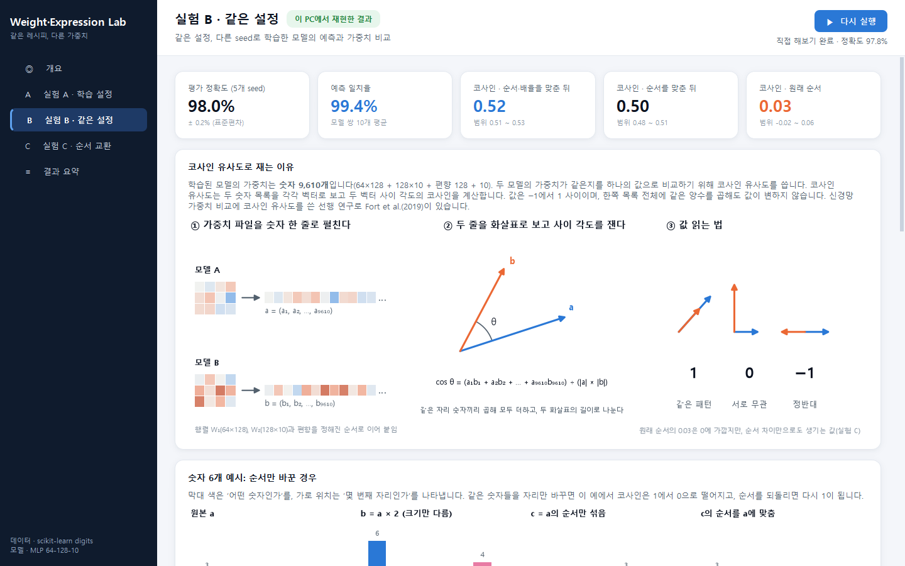
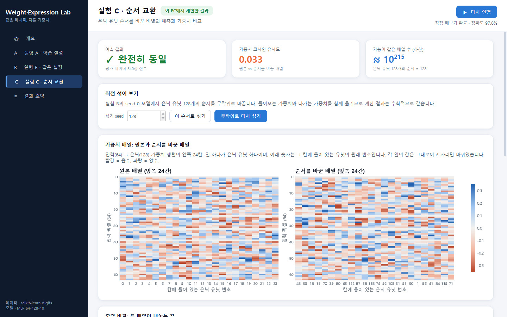
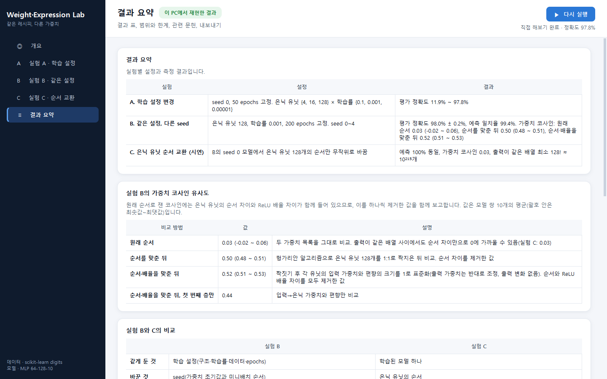

# Weight·Expression Lab — 같은 레시피, 다른 가중치

[](https://doi.org/10.5281/zenodo.23750443)

Hyunwoo Kim, Heonhui Lee — Department of Intellectual Property Convergence, Graduate School, Gyeongsang National University

같은 설정으로 학습한 신경망이 같은 가중치를 갖는지를 측정하는 재현 실험입니다.
작은 신경망을 처음부터 학습하여 학습 설정, 예측(기능), 가중치 수치 사이의 관계를 측정합니다.
명령줄 스크립트와 PyQt6 데스크톱 앱이 함께 들어 있으며, GPU 없이 CPU에서 약 10~15초면 전체 실험이 끝납니다.



## 측정하는 것

| 실험 | 질문 |
|---|---|
| A | 학습 설정(은닉 유닛 수·학습률)을 바꾸면 평가 정확도는 얼마나 달라지는가? |
| B | 학습 설정을 같게 두고 seed만 바꾸면 예측과 가중치는 얼마나 같은가? |
| C | 학습된 모델의 은닉 유닛 순서를 바꾸면 예측과 가중치는 어떻게 되는가? (시연) |

## 실험 설계

- **데이터**: scikit-learn `digits` (8×8 손글씨 숫자 1,797장, 10개 클래스). 패키지에 들어 있어 따로 내려받을 필요가 없습니다. 학습 70% / 평가 30%로 고정 분할(`random_state=0`, 층화 추출)합니다.
- **모델**: 은닉층 하나짜리 신경망 MLP 64-128-10 (`sklearn.neural_network.MLPClassifier`, ReLU, Adam, batch 64)을 처음부터 학습합니다. 가중치는 모두 9,610개입니다(64×128 + 128×10 + 편향 128 + 10).
- **seed**: `MLPClassifier`의 `random_state`. 가중치 초기값과 미니배치 순서를 정합니다.

## 결과

값은 `results.json`에 저장된 값입니다.

| 실험 | 설정 | 결과 |
|---|---|---|
| **A. 학습 설정 변경** | seed 0, 50 epochs 고정. 은닉 유닛 {4, 16, 128} × 학습률 {0.1, 0.001, 0.00001} | 평가 정확도 **11.9% ~ 97.8%** (10개 클래스이므로 무작위로 답할 때의 기대 정확도는 10%) |
| **B. 같은 설정, 다른 seed** | 은닉 유닛 128, 학습률 0.001, 200 epochs 고정. seed 0~4 | 평가 정확도 98.0% ± 0.2%, 모델 쌍 사이 예측 일치율 **99.4%**. 가중치 코사인 유사도: 순서·배율을 맞춘 뒤 **0.52** (0.51 ~ 0.53), 순서를 맞춘 뒤 0.50 (0.48 ~ 0.51), 원래 순서 0.03 (−0.02 ~ 0.06) |
| **C. 은닉 유닛 순서 교환 (시연)** | B의 seed 0 모델에서 은닉 유닛 128개의 순서만 무작위로 바꿈 | 예측 **100% 동일**, 가중치 코사인 유사도 0.03. 출력이 같은 가중치 배열은 최소 128! ≈ **10²¹⁵**개 |

B의 값은 모델 쌍 10개의 평균이고, 괄호 안은 최솟값 ~ 최댓값입니다.

## 코사인 유사도

### 쓰는 이유

두 모델의 가중치(숫자 9,610개)가 같은지를 하나의 값으로 비교하기 위해 코사인 유사도를 씁니다. 코사인 유사도는 두 숫자 목록을 각각 벡터로 보고 두 벡터 사이 각도의 코사인을 계산합니다. 값은 −1에서 1 사이이며, 한쪽 목록 전체에 같은 양수를 곱해도 값이 변하지 않습니다. 신경망 가중치 비교에 코사인 유사도를 쓴 선행 연구로 Fort et al.(2019)이 있습니다.

### 측정 방법



1. **펼치기**: 가중치 행렬 W₁(64×128), W₂(128×10)과 편향을 정해진 순서로 이어 붙여 숫자 9,610개짜리 벡터 a, b를 만듭니다.
2. **계산**: cos θ = (a₁b₁ + a₂b₂ + … + a₉₆₁₀b₉₆₁₀) ÷ (|a| × |b|). 같은 자리 숫자끼리 곱해 모두 더하고, 두 벡터의 길이로 나눕니다.
3. **값 읽기**:

| 값 | 의미 |
|---|---|
| 1 | 두 벡터의 방향이 같음 (한쪽이 다른 쪽의 양수배) |
| 0 | 두 벡터가 직교함 |
| −1 | 두 벡터의 방향이 정반대 |

### 숫자 6개 예시: 순서만 바꾼 경우



막대 색은 ‘어떤 숫자인가’를, 가로 위치는 ‘몇 번째 자리인가’를 나타냅니다. 크기만 두 배로 키우면 코사인은 1입니다. 같은 숫자들을 자리만 바꾸면 이 예에서 코사인은 0이 되고, 순서를 되돌리면 다시 1이 됩니다.

### 실험 B가 코사인을 세 가지로 보고하는 이유

ReLU 신경망에는 기능(출력)을 바꾸지 않고 가중치 수치만 바꾸는 변환이 두 가지 있습니다.

- **은닉 유닛의 순서 교환**: 유닛의 순서를 바꾸고 입력·출력 가중치를 함께 옮기면 출력이 같습니다(실험 C; Hecht-Nielsen, 1990).
- **유닛별 배율 조정**: 한 유닛의 입력 가중치와 편향에 양수 a를 곱하고 출력 가중치를 a로 나누면, ReLU(a·z) = a·ReLU(z)이므로 출력이 같습니다(Dinh et al., 2017).

원래 순서로 잰 코사인에는 이 두 가지 차이가 함께 들어 있습니다. 실험 C에서 보듯 출력이 같은 두 배열 사이에서도 원래 순서의 코사인은 0.03까지 낮아질 수 있습니다. 그래서 실험 B는 이 차이를 하나씩 제거한 값을 함께 보고합니다.

| 비교 방법 | 값 | 설명 |
|---|---|---|
| 원래 순서 | 0.03 (−0.02 ~ 0.06) | 두 가중치 목록을 그대로 비교 |
| 순서를 맞춘 뒤 | 0.50 (0.48 ~ 0.51) | 헝가리안 알고리즘(`scipy.optimize.linear_sum_assignment`)으로 두 모델의 은닉 유닛 128개를 가장 비슷한 것끼리 1:1로 짝지은 뒤 비교. 유닛 짝짓기는 Li et al.(2016), Ainsworth et al.(2023)에서 쓰인 방식과 같은 계열 |
| 순서·배율을 맞춘 뒤 | 0.52 (0.51 ~ 0.53) | 위 짝짓기에 더해, 각 유닛의 입력 가중치와 편향의 크기를 1로 표준화하고 출력 가중치를 반대로 조정한 뒤 비교. 이 표준화로 출력은 바뀌지 않음(출력값 차이 10⁻¹⁴ 수준) |
| 순서·배율을 맞춘 뒤, 첫 번째 층만 | 0.44 | 입력→은닉 가중치와 편향만 비교 |

tanh 신경망에서는, 입출력 기능이 같은 최소 신경망의 가중치가 순서 교환·부호 반전을 제외하면 유일하다는 것이 증명되어 있습니다(Sussmann, 1992). 이 실험의 모델은 ReLU 신경망이므로 순서와 배율 대칭을 모두 제거한 뒤 비교했습니다.

### 실험 B와 C의 비교

| | 실험 B | 실험 C |
|---|---|---|
| 같게 둔 것 | 학습 설정(구조·학습률·데이터·epochs) | 학습된 모델 하나 |
| 바꾼 것 | seed(가중치 초기값과 미니배치 순서) | 은닉 유닛의 순서 |
| 예측 | 모델 쌍 평균 99.4% 일치 | 100% 동일 |
| 가중치 코사인 | 순서·배율을 맞춘 뒤 0.52 | 0.03 |

실험 C는 새로운 현상의 발견이 아니라, 피드포워드 신경망에서 항상 성립하는 은닉 유닛의 순서 대칭성(Hecht-Nielsen, 1990; Chen et al., 1993)을 이 모델에서 직접 확인한 시연입니다. 은닉 유닛 128개를 늘어놓는 순서는 128!가지이고, ReLU 신경망에서는 배율 조정으로도 출력이 같은 배열을 만들 수 있으므로 128!은 하한입니다.

## 데스크톱 앱 (PyQt6)

```bash
python app.py
```

앱을 열면 저장된 결과(`results.json`)가 바로 보이고, 오른쪽 위 **▶ 실험 실행**을 누르면 이 PC에서 전체 실험을 다시 돌려 가중치 수준의 시각화까지 표시합니다. 실험은 백그라운드 스레드에서 돌아가므로 실행 중에도 화면을 둘러볼 수 있습니다.

| 화면 | 내용 |
|---|---|
| **개요** | 실험 목적, 실험별 핵심 수치, 데이터 예시 |
| **실험 A** | 은닉 유닛 × 학습률 정확도 히트맵. **직접 해보기**: 은닉 유닛 수·학습률·seed·epochs를 골라 모델 하나를 학습하고 정확도와 손실 곡선 확인 |
| **실험 B** | 코사인 유사도 측정 방법 그림과 숫자 6개 예시, 세 가지 코사인의 정의, 모델 쌍별 예측 일치율·가중치 코사인 행렬, 두 모델의 은닉 유닛 입력 가중치 비교 |
| **실험 C** | 원본 배열과 순서를 바꾼 배열 비교, 두 배열의 출력값 산점도. **직접 섞어 보기**: 순서를 다시 섞어 예측과 코사인을 즉시 확인. 관련 문헌 |
| **결과 요약** | 결과 표, 실험 B의 코사인 세 가지, B와 C의 비교, 범위와 한계, 관련 문헌, 결과 JSON·그래프 PNG(200 dpi) 내보내기 |

<table>
<tr>
<td></td>
<td></td>
</tr>
<tr>
<td></td>
<td></td>
</tr>
</table>

## 설치와 실행

Python 3.10 이상이 필요합니다.

```bash
git clone https://github.com/hwkim-gnu/weight-expression-exp.git
cd weight-expression-exp
python -m venv .venv
.venv\Scripts\activate          # macOS·Linux: source .venv/bin/activate
```

명령줄 실험만 실행할 때:

```bash
pip install -r requirements.txt          # scikit-learn, scipy, numpy
python run_experiment.py                 # 결과를 JSON으로 출력
python run_experiment.py > results.json
```

GUI까지 실행할 때:

```bash
pip install -r requirements-gui.txt      # 위 3개 + PyQt6, matplotlib
python app.py
```

## 파일 구성

| 파일 | 역할 |
|---|---|
| `core.py` | 실험 A·B·C 본체. 명령줄과 GUI가 같은 코드를 씁니다 |
| `run_experiment.py` | 명령줄 진입점. `results.json`과 같은 형식의 JSON 출력 |
| `app.py` | PyQt6 GUI |
| `results.json` | 저장된 결과 |
| `requirements.txt` / `requirements-gui.txt` | 명령줄용 / GUI용 패키지 목록 |
| `docs/` | README용 화면과 설명 그림 |

`results.json`의 `B_seed` 항목:

| 키 | 내용 |
|---|---|
| `weight_cosine_raw_mean`, `_range` | 원래 순서 코사인 |
| `weight_cosine_after_alignment_mean`, `_range` | 순서를 맞춘 뒤 코사인 |
| `weight_cosine_after_alignment_and_rescaling_mean`, `_range` | 순서·배율을 맞춘 뒤 코사인 |
| `first_layer_cosine_after_alignment_and_rescaling_mean` | 순서·배율을 맞춘 뒤 첫 번째 층만 비교한 코사인 |

## 재현성

- 데이터 분할과 모든 학습의 seed가 고정되어 있어, 같은 환경에서는 실행할 때마다 같은 값이 나옵니다.
- 실험 A의 **학습률 0.1** 조합은 학습이 불안정해서, 운영체제와 수치 연산 라이브러리(BLAS)에 따라 소수점 둘째 자리 정도 달라질 수 있습니다. Windows 11 + Python 3.13 환경에서는 은닉 16이 96.1%(저장값 94.8%), 은닉 128이 96.7%(저장값 97.2%)였고, 정확도 범위(11.9% ~ 97.8%)와 실험 B·C의 값은 저장값과 같았습니다. 앱은 실행 후 저장된 결과와 일치하는지 상단에 표시합니다.

## 범위와 한계

- 이 실험의 모델(MLP 64-128-10)과 데이터셋(digits)은 작습니다. 결과를 대형 모델에 그대로 적용할 수는 없습니다.
- seed에 따라 서로 다른 해에 도달하는 현상과 은닉 유닛의 순서 대칭성은 대형 모델에서도 보고되어 있습니다(Fort et al., 2019; Entezari et al., 2022; Ainsworth et al., 2023).

## 관련 문헌

| 문헌 | 내용 · 관련 실험 |
|---|---|
| Hecht-Nielsen, R. (1990). On the algebraic structure of feedforward network weight spaces. In R. Eckmiller (Ed.), *Advanced Neural Computers* (pp. 129–135). North-Holland. | 피드포워드 신경망 가중치 공간의 대칭성(은닉 유닛 순서 교환 등 기능을 바꾸지 않는 변환)을 다룸 · 실험 C |
| Chen, A. M., Lu, H., & Hecht-Nielsen, R. (1993). On the geometry of feedforward neural network error surfaces. *Neural Computation*, 5(6), 910–927. | 기능을 바꾸지 않는 가중치 변환이 군(group)을 이루며, 하나의 최적 가중치에 대해 기능이 같은 사본이 많이 존재함을 보임 · 실험 C |
| Sussmann, H. J. (1992). Uniqueness of the weights for minimal feedforward nets with a given input-output map. *Neural Networks*, 5(4), 589–593. | tanh 신경망에서, 입출력 기능이 같은 최소 신경망의 가중치는 순서 교환·부호 반전을 제외하면 유일함을 증명 · 실험 B |
| Dinh, L., Pascanu, R., Bengio, S., & Bengio, Y. (2017). Sharp minima can generalize for deep nets. *Proceedings of ICML 2017*, PMLR 70, 1019–1028. | ReLU 신경망에서 양수 배율 조정(한쪽에 α, 다른 쪽에 1/α)으로 기능이 같은 가중치를 만들 수 있음을 보임 · 실험 B·C |
| Li, Y., Yosinski, J., Clune, J., Lipson, H., & Hopcroft, J. (2016). Convergent learning: Do different neural networks learn the same representations? *ICLR 2016*. | 초기값만 다른 신경망들의 유닛을 이분 매칭 등으로 짝지어 비교, 일부 특징은 여러 신경망에서 공통으로 학습되고 일부는 그렇지 않음을 보고 · 실험 B |
| Fort, S., Hu, H., & Lakshminarayanan, B. (2019). Deep ensembles: A loss landscape perspective. arXiv:1912.02757. | 무작위 초기값이 다르면 서로 다른 해(mode)에 도달함을 보고, 가중치 비교에 코사인 유사도를 사용 · 실험 B |
| Entezari, R., Sedghi, H., Saukh, O., & Neyshabur, B. (2022). The role of permutation invariance in linear mode connectivity of neural networks. *ICLR 2022*. | 순서 대칭성을 고려하면 독립적으로 학습된 해들 사이의 선형 보간 장벽이 사라질 가능성이 높다는 추측을 제시하고 실험으로 검토 · 실험 B·C |
| Ainsworth, S. K., Hayase, J., & Srinivasa, S. (2023). Git Re-Basin: Merging models modulo permutation symmetries. *ICLR 2023*. | 한 모델의 은닉 유닛 순서를 기준 모델에 맞추는 정렬 알고리즘을 제시, 독립적으로 학습된 ResNet(CIFAR-10)에 적용 · 실험 B·C |

## 인용

| 대상 | DOI |
|---|---|
| v1.0 (이 버전) | [10.5281/zenodo.23750443](https://doi.org/10.5281/zenodo.23750443) |
| 모든 버전 (항상 최신 버전으로 연결) | [10.5281/zenodo.23750442](https://doi.org/10.5281/zenodo.23750442) |

> Kim, H., & Lee, H. (2026). *Weight·Expression Lab: Same recipe, different weights* (Version v1.0) [Computer software]. Zenodo. https://doi.org/10.5281/zenodo.23750443

인용 정보는 [`CITATION.cff`](CITATION.cff)에도 있습니다.

## 라이선스

[MIT License](LICENSE)
